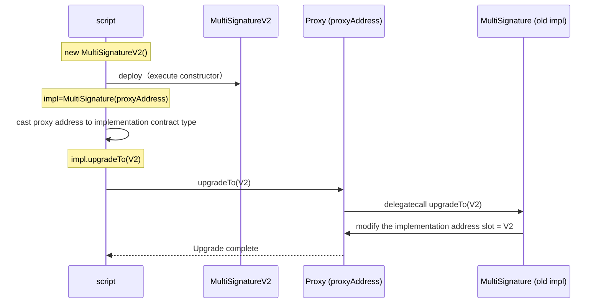
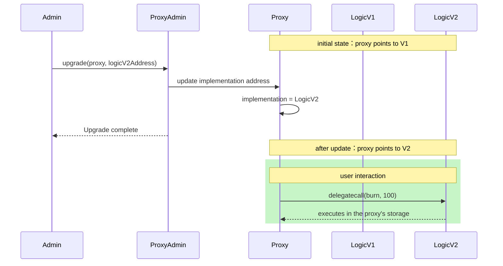

**UUPS**

We chose UUPS over the transparent proxy because UUPS puts the upgrade logic in the implementation contract, which makes the proxy smaller and cheaper on gas. The tradeoff is that the implementation must inherit `UUPSUpgradeable` and implement `_authorizeUpgrade`.

---

**transparent proxy**

